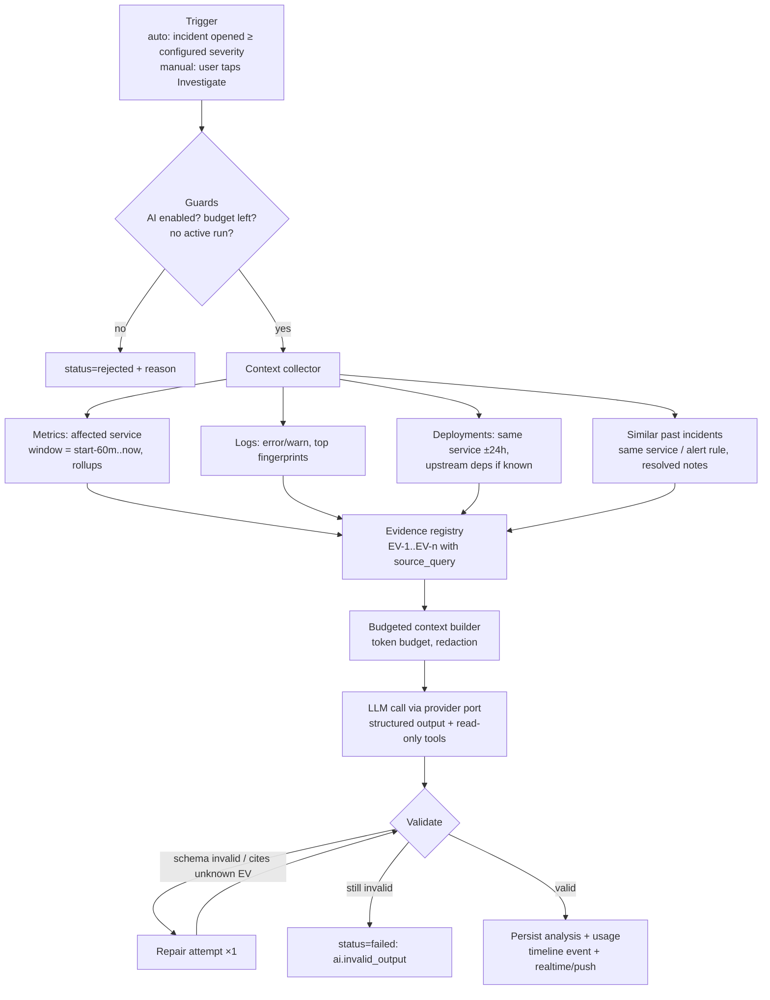

# DevPulse — AI Incident Investigator

**Status: implemented in Phase 4** (see §9 for what is in, what differs from the original plan, and what is open).

Goal: given an incident, produce an **evidence-grounded** analysis: what is known (evidence), what is suspected (hypotheses with calibrated confidence), what to check next. The AI never confirms root causes and never executes actions.

## 1. Pipeline



Runs as a Celery task (`ai.investigate`), status `queued → collecting → analyzing → succeeded|failed`. Hard wall-clock limit 90s per run.

## 2. Grounding: how "do not invent evidence" is enforced

1. **Evidence comes only from the collector**, never from the model. Each item gets a stable ref (`EV-3`), its `kind`, a compact excerpt (e.g. "p95 latency 180ms → 1.4s between 10:02 and 10:06") computed deterministically in Python, and the exact `source_query` used to fetch it.
2. The model must reference evidence by ref. The validator rejects any `evidence_refs` not in the registry, and any hypothesis with zero refs.
3. Numeric claims in free text are not trusted; the UI shows the evidence card's computed excerpt, not model-restated numbers.
4. Missing data is explicit: the collector adds `data_gaps` ("no logs ingested for checkout-api in window") which are passed to the model and shown to users.
5. `status` of a hypothesis is always `hypothesis`; only a human can set `incidents.root_cause_confirmed`.

## 3. Provider abstraction

```python
class LLMProvider(Protocol):
    name: str
    async def generate(
        self, *, model: str, system: str, messages: list[Message],
        tools: list[ToolSpec] | None, response_schema: type[BaseModel] | None,
        max_output_tokens: int, timeout_s: float,
    ) -> LLMResult: ...   # text | parsed | tool_calls, usage{input, output, cached}, raw_id
```

- Adapters: `AnthropicProvider` (default model `claude-opus-5-5`, official `anthropic` SDK), `FakeProvider` (scripted results for tests; a rule-based *demo analyzer* for offline demos — labelled "not an LLM" in every client, refused in production). An `OpenAIProvider` is **not implemented yet**; the port is the only thing it would need to satisfy.
- Selected per org from `ai_settings` + server env (`AI_DEFAULT_PROVIDER`, `AI_DEFAULT_MODEL`, `ANTHROPIC_API_KEY`). Keys are server configuration only: never accepted or returned by the API, never sent to web or mobile.
- Business logic (`InvestigationService`) depends only on the port. Prompt templates are versioned files (`prompt_version` stored per run).
- Pricing table per (provider, model) lives in config, not code, to compute `cost_micros`.

## 4. Output schema (Pydantic, enforced)

```json
{
  "incident_id": "INC-1024",
  "summary": "API latency increased shortly after deployment v2.14.0",
  "impact": "Elevated checkout latency (p95 1.4s vs 180ms baseline); error rate unchanged",
  "probable_causes": [
    {
      "cause": "Database connection pool exhaustion",
      "status": "hypothesis",
      "confidence": 0.62,
      "confidence_label": "medium",
      "reasoning": "Pool usage reached its limit at the same minute latency rose",
      "evidence_refs": ["EV-2", "EV-4"],
      "counter_evidence_refs": [],
      "how_to_verify": "Compare db.pool.connections_in_use against pool max after rollback"
    }
  ],
  "recommended_actions": [
    { "action": "Inspect database connection utilization", "kind": "investigate", "risk": "read_only" },
    { "action": "Roll back checkout-api to v2.13.2", "kind": "remediate", "risk": "sensitive", "requires_approval": true }
  ],
  "data_gaps": ["No logs ingested for checkout-api in the incident window"],
  "limitations": "Correlation in time does not prove causation; no tracing data available."
}
```

Validation rules beyond schema: 1–5 causes; `confidence ∈ [0,1]`; label must match bucket (<0.4 low, <0.75 medium, else high); confidence capped at 0.75 when a cause has a single evidence item; `risk ∈ {read_only, sensitive, destructive}`; anything non-read-only forces `requires_approval=true`. The example output in the brief is a subset of this schema.

## 5. Tools (read-only, bounded)

Exposed to the model for follow-up questions and deeper investigation:
`query_metric(service, metric, agg, from, to)`, `search_logs(service, level, contains, from, to, limit≤50)`, `list_deployments(service, from, to)`, `get_incident(number)`, `find_similar_incidents(service, limit≤5)`.

- All tools run through the same org-scoped repositories as the API (tenant isolation applies to the AI too).
- Each tool result is added to the evidence registry with a new ref → follow-up answers cite it the same way.
- Budget: ≤ 6 tool calls per turn, ≤ 20 per investigation; time ranges clamped to 7 days.
- There are **no** write/exec tools. Remediation is only ever a `recommended_action`; sensitive ones become `ai_action_proposals` that a user must approve, and in v1 approval only records the decision and links a runbook — DevPulse does not execute it.

## 6. Reliability

| Concern | Policy |
|---|---|
| Timeout | 45s per LLM call, 90s per run |
| Retry | provider 429/5xx/timeouts: 2 retries, exponential backoff + jitter; invalid output: 1 repair prompt with validation errors |
| Idempotency | one active run per incident (DB partial unique index); auto-trigger deduped by incident version |
| Degradation | AI failure never blocks incident workflows; UI shows "Analysis unavailable" + reason |
| Prompt injection | log/commit text is untrusted: wrapped in delimited data blocks, system prompt states it is data; tools are read-only so injection cannot cause actions |
| Privacy | configurable redaction (emails, tokens, IPs via regex) before sending; per-org opt-in; nothing sent if AI disabled |

## 7. Cost & usage tracking

Every provider call writes `ai_usage` (tokens in/out/cached, cost, latency, attempt, outcome). Before a run, the service checks month-to-date `cost_micros` vs `monthly_budget_micros` → `ai.budget_exceeded`. Usage visible on web (`/ai/usage`) and exported as Prometheus metrics (`devpulse_ai_tokens_total{provider,model}`).

## 8. Evaluation

- Schema tests: valid/invalid fixtures, unknown evidence refs, label/confidence mismatch, risk escalation.
- Golden scenarios (seeded incidents with known injected causes: bad deploy, pool exhaustion, upstream outage, noisy alert): run with `FakeProvider` in CI for pipeline correctness; with a real provider on demand (`make ai-eval`) to score top-1 cause hit rate and citation validity.
- User feedback (`helpful`) stored per investigation.

## 9. Phase 4 implementation notes

Code: `services/api/app/modules/ai/` — `providers/` (port, Anthropic, Fake), `collector.py`, `evidence.py`, `output.py` (schema + validation), `tools.py`, `pipeline.py` (Celery-side run), `service.py` + `router.py` (API), `scenarios.py` (golden scenarios), `prompts/*.md` (versioned prompts).

**Anthropic adapter.** `client.beta.messages.create` with: the frozen system prompt as a cached block (`cache_control: ephemeral`, so tools + system form a reusable prefix); structured output via `output_config.format` (JSON Schema in `output.py`); `output_config.effort` from `AI_EFFORT` (default `high`; adaptive thinking is on by default on the model); strict read-only tools for follow-ups; the server-side refusal fallback (`fallbacks: "default"`, beta `server-side-fallback-2026-07-01`) on models that support it. No sampling parameters are sent. The SDK does retries (2, exponential backoff + jitter) and the per-call timeout (45 s); SDK errors map to stable codes (`ai.rate_limited`, `ai.timeout`, `ai.provider_auth`, `ai.refused`, `ai.truncated`, …). Assistant turns (including thinking blocks) are replayed verbatim inside a tool loop.

**Collector windows.** Incident window = `started_at − 15 min` → `min(now, resolved_at, started_at + 2 h)`; baseline = the 60 min before that. The 15-minute lead keeps the pre-alert change out of the baseline (alerts fire after their window + `for`). Deployments: same service, 24 h before → 5 min after start. Logs: warn/error/fatal grouped by fingerprint, with a "seen in the previous 6 h" count. Similar incidents: same service, 90 days, resolved first.

**Validation.** Pydantic re-parse of the structured output, then: refs must exist; ≥1 ref per cause; 1–5 causes; confidence ∈ [0,1]; single-evidence causes capped at 0.75 (recorded in `adjustments`, shown to users); `status`, `confidence_label` and `requires_approval` are set by the server, never trusted from the model. One repair attempt with the validation errors; then `ai.invalid_output`.

**Guards & limits.** Per-org opt-in (off by default); provider must be configured on the server; month-to-date cost < budget (checked when queued *and* when the worker starts); `max_tokens_per_run` stops the repair step; 90 s per run; one active run per incident and one automatic run per incident (partial unique indexes); runs stuck > 10 min are failed by the hourly cleanup. A run with no telemetry at all fails with `ai.no_evidence` **without calling the model**.

**Follow-up questions** run synchronously in the request (bounded by the 90 s run timeout, ≤ 6 tool calls per question, ≤ 20 per investigation) instead of the planned SSE stream; answers are idempotent on `client_id`. A failed question stores nothing but its usage rows.

**Auto-trigger.** The outbox relay sees each `created` timeline event and calls `maybe_auto_investigate` (org setting `auto_investigate_min_severity`), which queues `ai.investigate` on Celery. Results reach clients via the `ai_analysis` timeline event (WebSocket hint) plus 3 s polling while a run is active.

**Proposals.** Non-read-only recommended actions become `ai_action_proposals`. Engineers decide sensitive ones, only admins/owners destructive ones; decisions are audited and added to the timeline. Nothing is ever executed (there is no `executed` status).

**Evaluation.** `make ai-eval` runs the four golden scenarios (bad deploy, pool exhaustion, upstream outage, noisy alert) through the real pipeline in a temporary org. With the demo analyzer it is free (4/4 today); `make ai-eval PROVIDER=anthropic` makes billed calls and needs `ANTHROPIC_API_KEY` — it has **not been run yet**.

**Open:** OpenAI adapter; per-org provider keys; SSE streaming of answers; Prometheus token metrics (usage is in `ai_usage` and `GET /ai/usage`); a real-model eval run.
