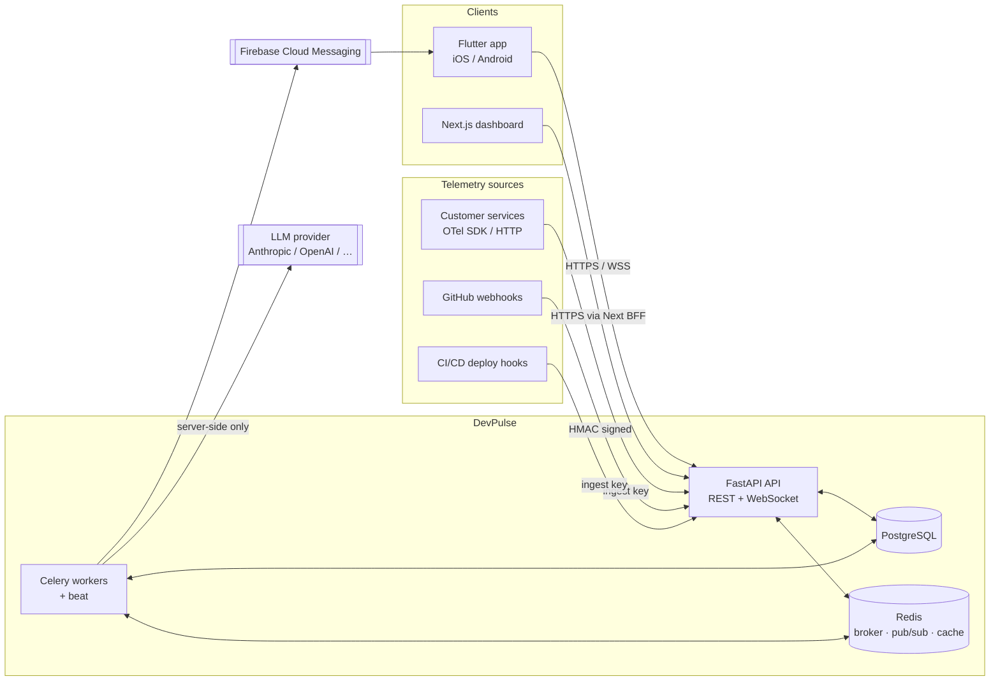
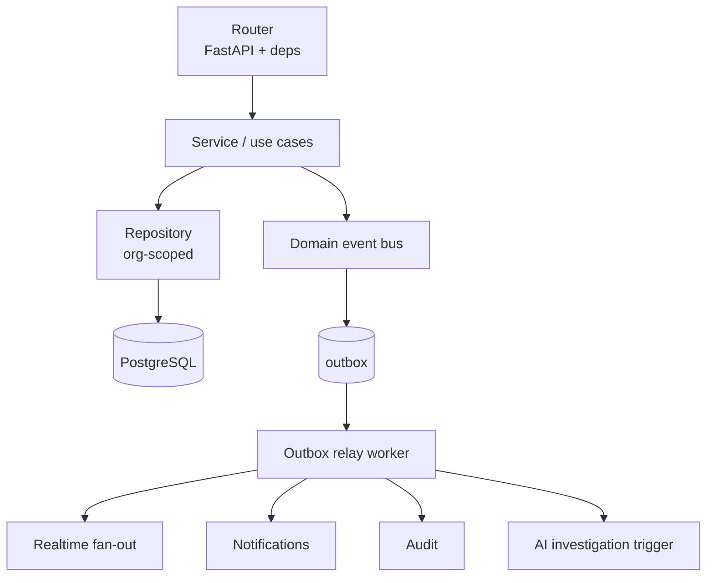
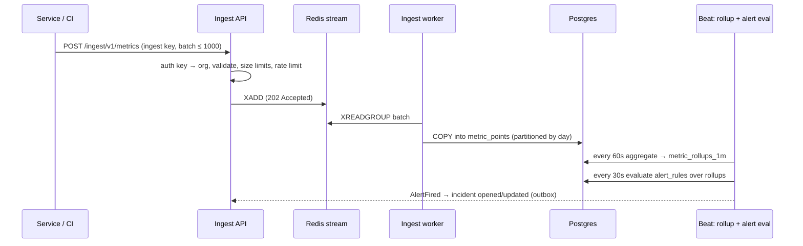
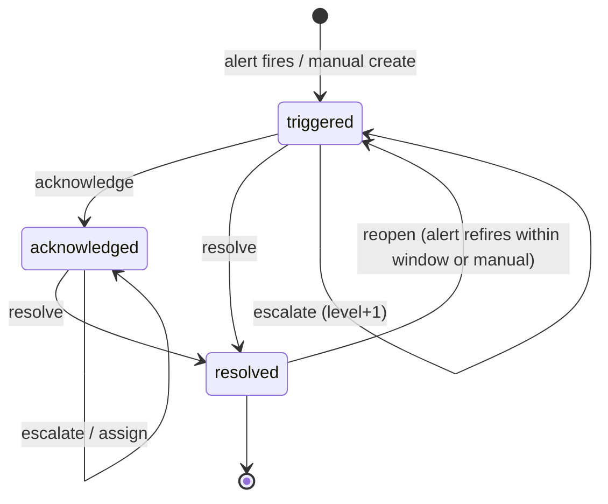

# DevPulse — System Architecture

## 1. Repository assessment (Phase 0, 2026-11-11)

- The workspace was **empty**: no existing code, no git repository, nothing to preserve.
- The workspace is a temporary folder; the project should move to a permanent, git-tracked location before Phase 1.
- Toolchain: Python 3.12, Node 25 + pnpm, Docker + Compose v5, JDK 17 are available.
  **Flutter is not installed** and `xcodebuild` is not usable — mobile work is blocked until fixed (see ROADMAP risks R1).
- No local PostgreSQL/Redis; they will run in Docker Compose, which is the intended path anyway.

## 2. Monorepo structure

```
devpulse/
├── apps/
│   ├── mobile/                  # Flutter app (feature-first, see MOBILE_ARCHITECTURE.md)
│   └── web/                     # Next.js dashboard (App Router)
├── services/
│   └── api/                     # FastAPI modular monolith + Celery workers
│       ├── app/
│       │   ├── core/            # config, db, security, errors, logging, tenancy, telemetry
│       │   ├── modules/
│       │   │   ├── auth/        # each module: router.py, schemas.py, service.py,
│       │   │   ├── users/       #   repository.py, models.py, events.py, tests/
│       │   │   ├── organizations/
│       │   │   ├── rbac/
│       │   │   ├── services/    # monitored services (catalog)
│       │   │   ├── telemetry/   # ingestion + ingest keys
│       │   │   ├── metrics/     # query, rollups
│       │   │   ├── alerts/      # rules + evaluation
│       │   │   ├── incidents/   # lifecycle, events, comments
│       │   │   ├── deployments/
│       │   │   ├── integrations/# GitHub, webhooks
│       │   │   ├── notifications/
│       │   │   ├── realtime/    # websocket gateway, redis fan-out
│       │   │   ├── sync/        # incremental change feeds
│       │   │   ├── ai/          # providers, context collector, investigations
│       │   │   └── audit/
│       │   ├── workers/         # celery app, beat schedule, task registration
│       │   └── main.py
│       ├── migrations/          # alembic
│       ├── seeds/               # demo seed — separate, opt-in, rows flagged is_demo
│       └── tests/               # cross-module integration tests
├── packages/
│   └── api-contract/            # exported openapi.json + generated Dart/TS clients
├── infra/
│   ├── compose/                 # docker-compose.yml, overrides
│   ├── otel/                    # collector config
│   ├── prometheus/  grafana/    # self-monitoring of DevPulse itself
│   └── docker/                  # Dockerfiles
├── docs/
├── .github/workflows/           # path-filtered CI per component
├── Makefile
└── .env.example
```

Why a monorepo: one PR can change the API, regenerate the contract and update both clients; CI catches contract drift. Path filters keep CI fast.

## 3. System context



## 4. Backend: modular monolith

One deployable, two process types (`api`, `worker`) from the same image.

**Module rules**
- A module owns its tables. Other modules call its **service** (Python interface), never its repository or models directly.
- Cross-module side effects go through an in-process **domain event bus** (e.g. `IncidentOpened`, `DeploymentFinished`). Handlers that do I/O or slow work enqueue Celery tasks. Events that must not be lost are written to an `outbox` table in the same transaction and relayed by a worker (transactional outbox).
- Layering inside a module: `router` (HTTP, auth deps) → `service` (use cases, transactions) → `repository` (SQLAlchemy). Pydantic schemas are the boundary types; ORM models never leave the repository/service layer.
- Use-case classes only where an operation has real business rules (e.g. `ResolveIncident`, `RunInvestigation`); simple reads stay as service methods.



### Cross-cutting core
| Concern | Approach |
|---|---|
| Config | `pydantic-settings`, one `Settings` object, validated at boot; app refuses to start on missing/invalid required vars |
| Errors | Domain exceptions → single handler → RFC 9457 `application/problem+json` with stable `code` |
| Logging | `structlog` JSON logs with `request_id`, `org_id`, `user_id`, `trace_id` |
| Tracing/metrics | OpenTelemetry instrumentation (FastAPI, SQLAlchemy, Celery, httpx); `/metrics` for Prometheus |
| Errors to humans | Sentry SDK (DSN optional; disabled when unset) |
| DB sessions | async SQLAlchemy 2 (`asyncpg`), one session per request/task, explicit transaction boundary in services |

## 5. Multi-tenancy and authorization

Tenant = **Organization**. Every tenant-owned row has `org_id NOT NULL`.

1. Org-scoped routes are `/api/v1/orgs/{org_id}/…`. The `org_id` in the path is **only a request** — the `require_org(permission)` dependency loads the caller's `membership` for that org, rejects with `404` if none (to avoid leaking existence) and `403` if the role lacks the permission.
2. The dependency yields an `OrgContext(org_id, user_id, role, permissions)`. Org-scoped repositories **require** an `OrgContext` in their constructor and add `WHERE org_id = :ctx.org_id` to every query; there is no unscoped method on them.
3. Child resources are fetched by `(org_id, id)`, never `id` alone, so a guessed UUID from another org is a 404.
4. Ingest keys and webhook secrets resolve to exactly one org server-side; payloads cannot choose their org.
5. Tests: a tenant-isolation suite creates two orgs and asserts every endpoint returns 404 cross-tenant (generated from the route table so new endpoints are covered automatically).
6. PostgreSQL Row-Level Security is planned as defense-in-depth for Phase 6 (ADR-004).

**Roles** (fixed in v1, permissions are code constants):

| Permission | owner | admin | engineer | viewer |
|---|---|---|---|---|
| org.manage, billing, delete org | ✓ | | | |
| members.manage, integrations.manage, ai.configure, alert_rules.manage | ✓ | ✓ | | |
| services.manage | ✓ | ✓ | ✓ | |
| incidents.act (ack/resolve/assign/escalate/comment) | ✓ | ✓ | ✓ | |
| ai.investigate | ✓ | ✓ | ✓ | |
| read everything in org | ✓ | ✓ | ✓ | ✓ |
| audit.read | ✓ | ✓ | | |

## 6. Telemetry pipeline



- Ingestion is accepted fast (202) and written asynchronously; backpressure via Redis stream length cap → `429` with `Retry-After`.
- An OTLP/HTTP-compatible endpoint (`/ingest/otlp/v1/metrics`, `/logs`) is planned for Phase 2b so standard OTel SDKs work unchanged.
- Logs are stored with short retention for incident evidence only; DevPulse is not a log search product (ADR-006).
- DevPulse's **own** observability (Prometheus/Grafana/Sentry) is separate from customer telemetry.

## 7. Alert → incident lifecycle



Every transition writes an `incident_events` row (the timeline) and bumps `incidents.version`. Alerts dedupe by `dedup_key = rule_id + service_id`: a refiring alert attaches to the open incident instead of creating a new one.

## 8. Realtime

- Client calls `POST /api/v1/realtime/ticket` → 30-second single-use ticket (avoids long-lived JWTs in URLs/logs), then connects `wss://…/ws?ticket=…`.
- Gateway subscribes to Redis channels `org:{org_id}` for each org the user belongs to; events are published by the outbox relay after commit (never before — no phantom events).
- Event envelope: `{type, org_id, entity, id, version, occurred_at, data}`. Clients upsert by `id` and drop events whose `version` ≤ the cached one → idempotent and duplicate-safe.
- WebSocket delivery is best-effort; correctness comes from the **sync feed** (see API.md §6). On reconnect clients run an incremental sync from their last cursor.
- Heartbeat: server ping every 25s; client treats 2 missed pongs as disconnect.

## 9. Web dashboard

- Next.js App Router; server components for initial loads, TanStack Query for client-side data and mutations.
- Auth via a thin **BFF**: Next route handlers hold access/refresh tokens in `httpOnly; Secure; SameSite=Lax` cookies and proxy to the API, so tokens are never readable by browser JS (ADR-007).
- Focus: administration (members, RBAC, alert rules, integrations, AI config, audit log) and dense analysis (multi-series charts, incident/deploy correlation timelines) — not a copy of mobile.

## 10. Non-goals for v1
- Microservices, Kafka, multi-region.
- Full log search / APM tracing UI.
- Custom roles (fixed roles first).
- Any AI-executed remediation.
