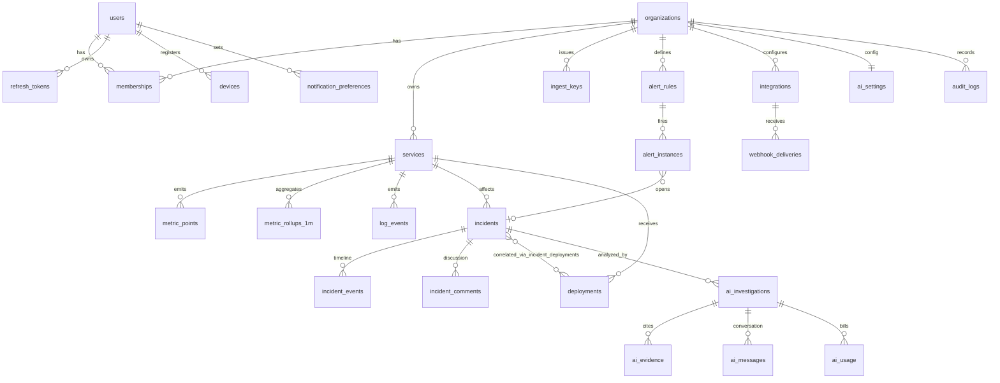

# DevPulse — Database Schema (PostgreSQL 16)

Implementation status: tables marked ✅ exist in Alembic migration `0f5be392b9a7` (Phase 1). Phase 2 (`ffc45990221d`) adds: services, ingest_keys, metric_points + log_events (daily RANGE partitions + DEFAULT partition, managed by `devpulse_ensure_partitions()`), metric_rollups_1m (not yet partitioned), alert_rules, alert_instances, incidents, incident_events, incident_comments, incident_deployments, idempotency_keys, deployments, integrations, webhook_deliveries. Phase 3 (`2c0c10bc3de7`) adds: `change_seq` on services/incidents/deployments (sequence `sync_change_seq`, stamping + outbox triggers, indexes `(org_id, change_seq)`), `outbox` (identity id, org_id, topic, payload, published_at; trigger-written), `notification_preferences`, and an `incident_events` → outbox trigger. Not yet built: metric_rollups_1h, notifications (inbox), AI tables, identity_links.

Phase 2 differences from the design below: alert rules target exactly one service (`service_id` NOT NULL; selectors later); `alert_instances` is unique per open episode per rule; ingest keys carry `is_demo` (telemetry from a demo key is flagged demo); integration secrets are a Fernet ciphertext column (`secret_encrypted`).

Conventions
- Primary keys: `uuid` (UUIDv7, time-ordered → good index locality, safe to expose).
- Human-friendly incident numbers: `incidents.number` per org (`INC-1024`), allocated from `organizations.incident_seq` inside the insert transaction.
- Every tenant-owned table: `org_id uuid NOT NULL REFERENCES organizations`, and every index on it leads with `org_id`.
- Mutable entities: `created_at`, `updated_at timestamptz` (trigger-maintained), `version int` (optimistic concurrency), `deleted_at` (soft delete → sync tombstones), and on synced tables (services, incidents, deployments) `change_seq bigint` indexed `(org_id, change_seq)` — see API.md §6.
- `is_demo boolean NOT NULL DEFAULT false` on services, incidents, deployments, metric/log data. Demo seed always sets it; real ingestion can never set it. UIs badge demo data.
- Money/tokens: integers (`cost_micros` = USD × 10⁶).
- All schema changes via Alembic; no `create_all` outside tests.

## ER diagram

## Identity & tenancy

**users** — `id, email UNIQUE (stored lower-cased/trimmed; normalised in the API rather than via citext), password_hash (argon2id, nullable for OIDC-only), display_name, avatar_url, theme_pref, last_login_at, tokens_valid_after (access tokens issued earlier are rejected), created_at, updated_at, disabled_at` ✅ Phase 1

**organizations** — `id, slug UNIQUE, name, incident_seq bigint DEFAULT 1000, created_at, updated_at, deleted_at`

**memberships** — `id, org_id, user_id, role enum(owner,admin,engineer,viewer), invited_by, created_at` · `UNIQUE(org_id,user_id)` · every org keeps ≥1 owner, enforced in the service by locking the org's owner rows (`SELECT … FOR UPDATE`) before demote/remove ✅ Phase 1

**invitations** — `id, org_id, email, role, token_hash, invited_by, expires_at, accepted_at, revoked_at, created_at` · partial UNIQUE `(org_id, email) WHERE accepted_at IS NULL AND revoked_at IS NULL` ✅ Phase 1

**refresh_tokens** — `id, user_id, family_id, token_hash UNIQUE, device_id, expires_at, rotated_at, revoked_at, created_ip, user_agent` · reuse of a rotated token revokes the whole `family_id` (theft detection)

**identity_links** (OIDC, later) — `id, user_id, issuer, subject, UNIQUE(issuer,subject)`

**devices** — `id, user_id, platform enum(ios,android,web), fcm_token, app_version, last_seen_at` · `UNIQUE(fcm_token)`

## Service catalog & telemetry

**services** — `id, org_id, slug, name, description, environment (prod/staging/…), tier enum(critical,high,low), owner_team, repo_url, health enum(healthy,degraded,critical,unknown), health_changed_at, tags jsonb, is_demo, version, timestamps, deleted_at` · `UNIQUE(org_id, environment, slug)`

**ingest_keys** — `id, org_id, service_id NULL, name, prefix (shown), key_hash (sha256), scopes text[], last_used_at, revoked_at, created_by`

**metric_points** — raw points, **range-partitioned by day on `ts`** · `org_id, service_id, name text, ts timestamptz, value double precision, labels jsonb, is_demo` · BRIN on `ts`, btree `(org_id, service_id, name, ts DESC)` · retention 7 days (drop partitions)

**metric_rollups_1m** — `org_id, service_id, name, bucket timestamptz, count, sum, min, max, p50, p95, p99` · PK `(org_id, service_id, name, bucket)` · partitioned monthly · retention 90 days. A `metric_rollups_1h` table follows the same shape (retention 13 months).

Standard metric names (initial): `http.server.requests` (count), `http.server.errors`, `http.server.duration_ms`, `process.cpu.utilization`, `process.memory.usage_bytes`, `db.pool.connections_in_use`.

**log_events** — partitioned by day · `org_id, service_id, ts, level, message (≤ 8 KB), attributes jsonb, trace_id, fingerprint` · retention 7 days · used as AI evidence, not general search.

## Alerts & incidents

**alert_rules** — `id, org_id, service_id NULL (null = all services matching selector), name, metric, aggregation enum(avg,p95,p99,sum,rate), comparator, threshold, window_s, for_s (must hold this long), severity enum(sev1..sev4), selector jsonb, enabled, created_by, version, timestamps`

**alert_instances** — `id, org_id, rule_id, service_id, state enum(pending,firing,resolved), dedup_key, started_at, fired_at, resolved_at, last_value, incident_id NULL` · partial UNIQUE `(org_id, dedup_key) WHERE state <> 'resolved'`

**incidents** — `id, org_id, number, title, summary, severity enum(sev1..sev4), status enum(triggered,acknowledged,resolved), service_id, assignee_id NULL, escalation_level smallint, source enum(alert,manual,api), started_at, acknowledged_at, resolved_at, root_cause_confirmed text NULL (human-entered only), is_demo, version, timestamps, deleted_at` · `UNIQUE(org_id, number)` · index `(org_id, status, severity, started_at DESC)`, `(org_id, change_seq)` for sync

**incident_events** (append-only timeline) — `id, org_id, incident_id, type enum(created,acknowledged,resolved,reopened,assigned,escalated,severity_changed,comment_added,alert_attached,deployment_correlated,ai_analysis_completed), actor_type enum(user,system,ai), actor_id, data jsonb, created_at` · index `(org_id, incident_id, created_at)`

**incident_comments** — `id, org_id, incident_id, author_id, body (markdown, ≤ 10 KB), client_id uuid UNIQUE (idempotent offline posting), edited_at, deleted_at, created_at`

**incident_deployments** — `org_id, incident_id, deployment_id, correlation enum(suspected,ruled_out,confirmed), score real, set_by enum(system,user,ai)` · PK `(incident_id, deployment_id)`

## Deployments & integrations

**deployments** — `id, org_id, service_id, environment, version, commit_sha, commit_message, commit_author, branch, repo_url, build_status enum(pending,running,succeeded,failed), status enum(started,succeeded,failed,rolled_back), started_at, finished_at, source enum(github,api,manual), external_id, is_demo, timestamps` · `UNIQUE(org_id, source, external_id)` (idempotent webhooks) · index `(org_id, service_id, started_at DESC)`

**integrations** — `id, org_id, kind enum(github,generic_webhook,slack…), name, config jsonb (non-secret), secret_ref (encrypted with app KMS key; never returned by API), status, created_by, timestamps`

**webhook_deliveries** — `id, org_id, integration_id, delivery_id UNIQUE, event, signature_valid, received_at, processed_at, error, payload_ref` · retention 30 days

**outbox** — `id bigserial, org_id, topic, payload jsonb, created_at, published_at NULL` · index on `published_at IS NULL`

## Notifications

**notification_preferences** — `user_id, org_id, channel enum(push,email), min_severity, only_assigned bool, quiet_hours jsonb` · PK `(user_id, org_id, channel)`

**notifications** — `id, org_id, user_id, kind, title, body, route (deep link), read_at, created_at`

## AI

**ai_settings** — `org_id PK, enabled, provider, model, monthly_budget_micros, max_tokens_per_run, auto_investigate_min_severity, data_redaction jsonb, updated_by`

**ai_investigations** — `id, org_id, incident_id, trigger enum(auto,manual), status enum(queued,collecting,analyzing,succeeded,failed,rejected), provider, model, prompt_version, context_hash, result jsonb (validated schema), error_code, started_at, finished_at, requested_by`

**ai_evidence** — `id, org_id, investigation_id, ref ("EV-3"), kind enum(metric,log,deployment,incident,alert), source_query jsonb (how it was fetched → reproducible), excerpt jsonb, observed_at`

**ai_messages** — `id, org_id, investigation_id, role enum(user,assistant,tool), content, tool_name, created_at, author_id`

**ai_usage** — `id, org_id, investigation_id, provider, model, input_tokens, output_tokens, cached_tokens, cost_micros, latency_ms, attempt, outcome, created_at` · index `(org_id, created_at)` for budget checks

**ai_action_proposals** — `id, org_id, investigation_id, kind, description, risk enum(read_only,sensitive,destructive), status enum(proposed,approved,rejected,executed), decided_by, decided_at` (v1: proposals are recorded and approved/rejected; no automatic execution)

## Audit

**audit_logs** — `id, org_id, actor_id, actor_type, action ("member.role_changed"), target_type, target_id, before jsonb, after jsonb, ip, user_agent, request_id, created_at` · append-only: a `BEFORE UPDATE` trigger rejects updates (DELETE stays possible for org cascade/retention) ✅ Phase 1 · monthly partitioning deferred to Phase 6 (volume is tiny until then).

## Retention summary

| Data | Retention |
|---|---|
| metric_points, log_events | 7 days |
| metric_rollups_1m | 90 days |
| metric_rollups_1h | 13 months |
| webhook_deliveries | 30 days |
| incidents, events, comments, deployments, AI | indefinite (until org deletion) |
| audit_logs | 1 year minimum |
