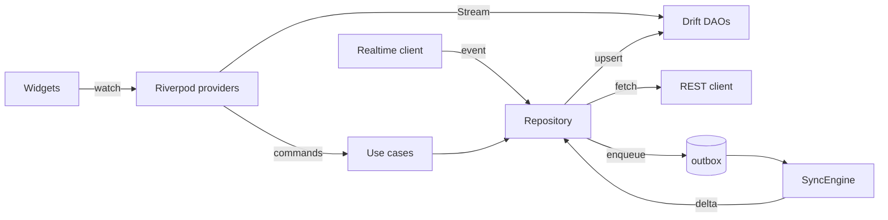
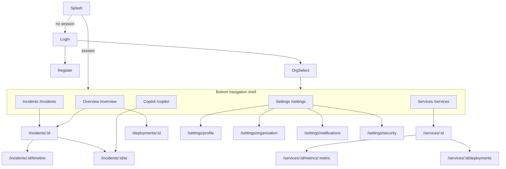

# DevPulse Mobile — Architecture

Flutter 3.47.9 (Dart 3.13), Riverpod 3.5 (no codegen yet — ADR-015), go_router 18, Dio 5.11, Drift 2.35, flutter_secure_storage 11. Planned for later phases: Freezed + json_serializable (Phase 2), firebase_messaging, web_socket_channel, workmanager, connectivity_plus (Phase 3).

**Status (Phase 3):** §1–5 and §7 are implemented and tested; §6 deep links route in-app (`/incidents/INC-1042`) and push routing is implemented behind a `PushMessages` interface, but **real FCM delivery and universal-link platform files (AASA / assetlinks) are not configured** — they need a Firebase project, APNs key and a public domain.

As built:
- `features/offline/`: `LocalStore` (Drift v2 tables `cached_services|incidents|deployments`, `sync_cursors`, `outbox_entries`), `SyncEngine` (single-flight per collection with re-run-if-dirty; page + cursor in one transaction), `OutboxProcessor` (ordered replay, Idempotency-Key + If-Match, full-jitter backoff 2 s → 2 min, conflict → refresh + notice, permanent failure → `failed`), `RealtimeClient` (ticket, WS, 1 s → 30 s backoff, resync on hello), `LiveSync` (wires them to connectivity and lifecycle; 30 s background grace before closing the socket).
- Optimistic actions: the cached row carries `pending_action`; reads overlay the expected status, so the item leaves "Open" immediately and shows a clock until the server confirms.
- Comments queued offline appear as "waiting to send" and are idempotent on `client_id`.
- Screens read Drift streams (Incidents, Services, Deployments, service detail sections); Overview and incident timeline/comments are network-first with the last copy kept on the device.

## 1. Layout (feature-first)

```
lib/
├── main.dart / bootstrap.dart        # env, Sentry, ProviderScope, error zones
├── app/
│   ├── router/                       # GoRouter config, guards, deep-link parsing
│   └── app.dart                      # MaterialApp.router, theming, lifecycle observer
├── core/
│   ├── design_system/                # tokens, theme, components (DESIGN_SYSTEM.md)
│   ├── network/                      # Dio client, auth interceptor, retry/backoff, problem+json → Failure
│   ├── database/                     # Drift db, DAOs, migrations, outbox table
│   ├── sync/                         # SyncEngine, cursors, outbox processor, conflict policy
│   ├── realtime/                     # WS client, reconnect policy, event dispatch
│   ├── auth/                         # token store, session controller
│   ├── push/                         # FCM registration, payload → route
│   ├── connectivity/                 # online/offline stream
│   └── result/                       # Result<T, Failure>, Failure types
└── features/
    ├── auth/  overview/  services/  incidents/  copilot/  deployments/  settings/
    │   ├── domain/        # entities (Freezed), repository interfaces, use cases with real rules
    │   ├── data/          # DTOs, remote data source (generated client), local DAO, repository impl
    │   └── presentation/  # screens, widgets, Riverpod notifiers/controllers
```

Rules: `presentation → domain ← data`. Presentation never imports Dio or Drift. DTOs never reach widgets. Use cases exist where there is logic (e.g. `AcknowledgeIncident` = optimistic update + outbox enqueue + conflict handling), not as one-line passthroughs.

## 2. Single source of truth: the local database



- Screens **watch Drift queries**; network results are written into Drift, never rendered directly. Realtime events, sync deltas and page fetches all converge on `upsert by id where incoming.version > local.version`.
- This is what prevents duplicates when a WebSocket event arrives for an item that's also on a paginated page: there is only one row per id, and the list is a DB query.
- Pagination: list = local query (filters + keyset ordering `started_at DESC, id`). Reaching the end triggers `fetchPage(cursor)` which upserts; per-filter cursors are stored in a `page_cursors` table so back navigation and app restarts resume.

## 3. Offline-first & sync

| Aspect | Design |
|---|---|
| Read offline | Services, open incidents + 7 days resolved, recent deployments, last AI analysis per incident, cached metric series (last viewed range) |
| Delta sync | `SyncEngine` pulls `/sync/{collection}` from stored cursor on: app start, resume, reconnect, push received, periodic background task |
| Background | `workmanager` periodic task (Android ≈15 min min; iOS BGAppRefresh is opportunistic — never relied on for correctness) |
| Writes offline | Commands (ack, resolve, assign, comment) applied optimistically to Drift with `pending=true`, queued in `outbox` with an `Idempotency-Key` and the `base_version` |
| Retry | Exponential backoff with full jitter: base 1s, cap 60s, max 8 attempts; retry only network errors/5xx/429 (honour `Retry-After`) |
| Conflicts | Server is authoritative. Incident actions are **commands**, not field patches: `409 version_mismatch` → re-fetch, re-check whether the command still applies (e.g. already resolved by someone else → drop & inform user "Resolved by Alex 2m ago"), otherwise retry once against the new version. Comments are append-only with `client_id` → no conflicts. Settings use last-write-wins |
| Failure surfacing | Permanently failed outbox items show an inline "Couldn't sync — Retry / Discard" on the affected item |
| Cache bounds | Prune resolved incidents > 30 days, metric caches > 24h; DB wiped on logout/org switch |

## 4. Auth & session

- Tokens in `flutter_secure_storage` (Keychain / Android Keystore-backed EncryptedSharedPreferences). Never in Drift or logs.
- Dio `QueuedInterceptor`: on `401 auth.token_expired`, a **single-flight** refresh; concurrent requests wait and replay. Refresh failure (`auth.refresh_reused`/invalid) → session cleared → router redirects to login, preserving the intended location for after re-auth.
- Session restoration at launch: read tokens → show cached data immediately → refresh in background. App works offline with an expired access token for reads.
- Organization selection after login if >1 membership; current org persisted; switching org clears org-scoped tables.

## 5. Navigation

`StatefulShellRoute.indexedStack` with 5 branches → each tab keeps its own stack, scroll position and filter state when switching tabs or returning from detail.



- Copilot tab = list of incidents with AI analyses + "Investigate" entry point; `/incidents/:id/ai` is the evidence-backed analysis + conversation.
- Deployments are reached from Overview, Service detail and Incident detail (correlations) rather than a 6th tab.
- Filter/search state lives in `keepAlive` Riverpod notifiers keyed per branch and is also encoded in the URL query (`/incidents?status=triggered&sev=sev1`) so deep links and restoration reproduce it.
- Tablets/landscape (≥ 840 dp): `NavigationRail` + list/detail split view on Incidents and Services.

## 6. Deep links & push routing

- Schemes: `devpulse://incidents/INC-1024` and universal/app links `https://app.devpulse.dev/o/{org_slug}/incidents/INC-1024` (AASA + assetlinks.json served by the web app).
- A link carries the org; if it differs from the current org and the user is a member, the app switches org (confirming if there are unsynced writes); otherwise shows "You don't have access".
- FCM **data** messages: `{route, org_id, incident_id, severity, version}`. Foreground → in-app banner + trigger delta sync; background tap → route after session restore; cold start uses `getInitialMessage()`. Sev1 uses a high-importance Android channel and iOS `time-sensitive` interruption level (critical alerts entitlement is out of scope).
- Notification actions "Acknowledge" on Android/iOS go through the same outbox path.

## 7. Realtime client

- Connect only while foregrounded and authenticated; obtain a WS ticket first.
- Reconnect: exponential backoff + jitter (1s → 30s), reset after 60s stable; immediate attempt on connectivity regained or app resume.
- On every (re)connect: run delta sync first, then apply live events (events with version ≤ local are ignored).
- Close socket 30s after app goes to background (lifecycle observer); FCM covers background.

## 8. States & UX quality

Every data screen is modelled as `AsyncState { data?, isRefreshing, error?, isStale, isOffline }` so cached content stays visible with an error/offline banner instead of being replaced by a spinner. Pull-to-refresh on all lists. Skeletons for first load only. Haptics on ack/resolve. Semantic labels on charts (summary sentence), Dynamic Type up to 200%, min 48dp targets, reduced-motion support.

## 9. Testing

| Level | What |
|---|---|
| Unit | use cases, sync cursor logic, backoff policy, conflict resolution, deep-link parser, push payload → route |
| Repository | Drift in-memory DB + mocked remote: upsert/version rules, dedupe with WS events, outbox replay |
| Widget | each screen in loading/empty/error/offline/data states (golden tests for design-system components) |
| Integration (`integration_test`) | login → org select → incident list → ack offline → reconnect → synced; deep link cold start |

## 10. Platform-specific risks

- iOS background execution is not guaranteed → never required for correctness.
- FCM requires a Firebase project + APNs key (user-provided, Phase 3).
- Flutter SDK is not installed on this machine yet (ROADMAP R1).
